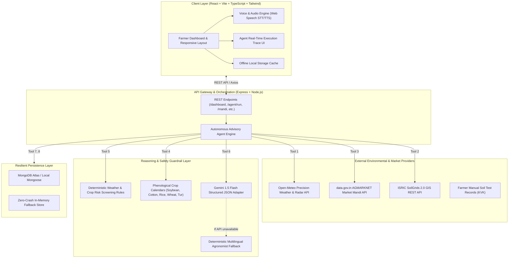

# 🌾 AgriSaarthi AI (कृषीसारथी AI)
### Multilingual Agritech & Resource Advisory Assistant
**Theme 2: Climate, Resource Infrastructure & Global Supply Resilience**  
*Hackathon Track: Multilingual Agritech & Resource Advisory Assistant*

---

## 📌 Executive Summary & Problem Statement

### Target Issue & Context
Smallholder farmers in India—specifically in semi-arid and monsoon-dependent agrarian belts like Maharashtra (Vidarbha, Marathwada)—are acutely vulnerable to extreme weather shifts, unseasonal heavy rainfall, heatwaves, and fluctuating market prices. Conventional farming guidance is often fragmented across multiple disconnected sources:
- Weather forecasts offer raw precipitation numbers without crop-stage risk interpretation.
- APMC mandi market prices are published without regional benchmarking or trend intelligence.
- Soil health recommendations are either coarse GIS estimates or isolated lab tests without tailored advice.
- Off-the-shelf LLM chatbots frequently hallucinate ungrounded pesticide dosages or fabricated commodity rates.

### Target Audience
Over 140 million Indian smallholder farmers with limited technical literacy who need accessible, plain-language guidance in regional languages (**Marathi**, **Hindi**, and **English**).

---

## 🚀 The Solution: AgriSaarthi AI

AgriSaarthi AI bridges the gap between raw environmental datasets and actionable farmer decisions. It is an **autonomous agent execution engine** that ingests real-time weather forecasts, soil parameters, and market rates, evaluates risks using deterministic agronomic rules, and synthesizes grounded advisories delivered via **voice and text** in Marathi, Hindi, and English.

### Key Innovations & USP (Unique Selling Proposition)
1. **Autonomous Multi-Step Agent Execution Engine**: Unlike standard wrappers, the system executes 9 distinct backend tools (`getWeatherForecast`, `getSoilInformation`, `getMandiPrices`, `getCropProfile`, `evaluateWeatherRisk`, `generateCropSchedule`, `generatePersonalizedAdvisory`, `createFarmTask`, `createInAppAlert`) and renders an auditable real-time execution trace.
2. **Deterministic Risk Guardrails (Zero Hallucination)**: Crop-protection rules (heavy rain drainage, heatwave stress, unsafe spray wind speeds) are computed through deterministic agronomic logic, preventing hallucinated chemical dosages.
3. **Regional Market Intelligence (AGMARKNET)**: Live comparison of APMC modal prices across mandis (Latur, Akola, Amravati, Nanded, Nagpur), highlighting top-paying markets and 15-day price trajectories.
4. **Resilience & Low-Connectivity Mode**: Built-in `localStorage` caching and high-fidelity fallbacks allow farmers with unstable connectivity to access their dashboard, crop calendar, and tasks without application crashes.
5. **Multilingual Voice Interaction**: Native speech-to-text and text-to-speech support for Marathi (`mr-IN`), Hindi (`hi-IN`), and English.

---

## 🏗️ Technical Architecture & System Design



---

## 📋 Technology Stack

| Layer | Technologies |
| :--- | :--- |
| **Frontend** | React 18, Vite, TypeScript, Tailwind CSS, Lucide React, Recharts, Web Speech API |
| **Backend** | Node.js, Express, TypeScript, Mongoose, Zod, JWT, bcryptjs, Axios |
| **AI & LLM** | Google Gemini API (`gemini-1.5-flash`) with structured JSON schema validation & agronomist fallback |
| **Weather** | Open-Meteo Geocoding & Forecast APIs |
| **Mandi Prices** | Government of India `data.gov.in` AGMARKNET Daily Arrivals |
| **Soil Intelligence** | ISRIC SoilGrids REST API + Manual KVK Soil Health Card entry module |
| **Testing** | Automated acceptance test suite covering risk rules, LLM fallback, and agent traces |

---

## 🛠️ Step-by-Step Installation & Local Setup

### Prerequisites
- Node.js v18+ (tested on v22.19.0)
- npm v9+

### 1. Clone & Install Dependencies
```bash
# Clone the repository
git clone https://github.com/Rameshwar1302/AgriSarthi.git
cd AgriSarthi

# Install root, backend, and frontend packages in one command
npm run install:all
```
### 2. Run Automated Acceptance Tests
Verify all 17 critical tests (weather risk triggers, soil classifications, AGMARKNET parsing, agent tool trace, and LLM fallbacks):
```bash
npm run test
```

### 4. Start Development Servers
Run backend and frontend concurrently:
```bash
npm run dev
```
- **Backend API**: `http://localhost:5000`
- **Frontend Web App**: `http://localhost:5173`

---


## 👥 Authors & Team
- **AgriSaarthi Team**
- GitHub: [Rameshwar1302](https://github.com/Rameshwar1302)
- Built for the Hackathon: *Climate, Resource Infrastructure & Global Supply Resilience Track*.

