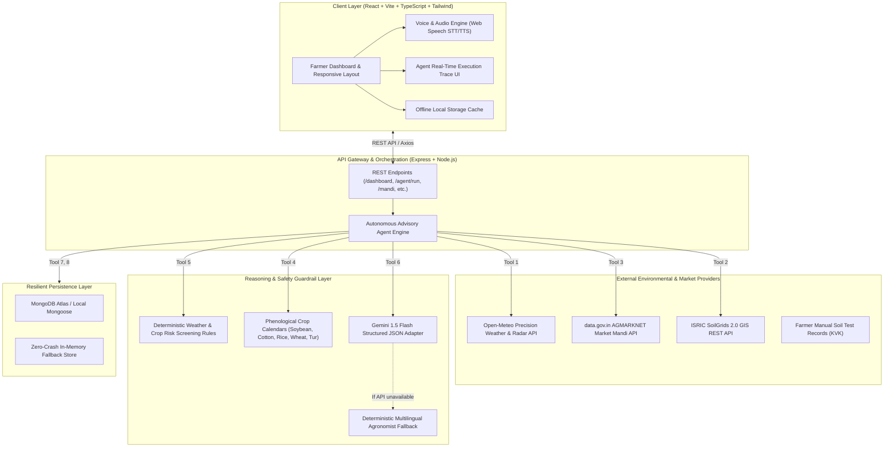

# 🌾 AgriSaarthi AI (कृषीसारथी AI)
### Multilingual Agritech & Resource Advisory Assistant
**Theme 2: Climate, Resource Infrastructure & Global Supply Resilience**  
*Hackathon Track: Multilingual Agritech & Resource Advisory Assistant*

---

## 📌 Executive Summary & Problem Statement

### Target Issue & Context
Smallholder farmers in India—specifically in semi-arid and monsoon-dependent agrarian belts like Maharashtra (Vidarbha, Marathwada)—are acutely vulnerable to extreme weather shifts, unseasonal heavy rainfall, heatwaves, and fluctuating market prices. Conventional farming guidance is often fragmented across multiple disconnected sources:
- Weather forecasts offer raw precipitation numbers without crop-stage risk interpretation.
- APMC mandi market prices are published without regional benchmarking or trend intelligence.
- Soil health recommendations are either coarse GIS estimates or isolated lab tests without tailored advice.
- Off-the-shelf LLM chatbots frequently hallucinate ungrounded pesticide dosages or fabricated commodity rates.

### Target Audience
Over 140 million Indian smallholder farmers with limited technical literacy who need accessible, plain-language guidance in regional languages (**Marathi**, **Hindi**, and **English**).

---

## 🚀 The Solution: AgriSaarthi AI

AgriSaarthi AI bridges the gap between raw environmental datasets and actionable farmer decisions. It is an **autonomous agent execution engine** that ingests real-time weather forecasts, soil parameters, and market rates, evaluates risks using deterministic agronomic rules, and synthesizes grounded advisories delivered via **voice and text** in Marathi, Hindi, and English.

### Key Innovations & USP (Unique Selling Proposition)
1. **Autonomous Multi-Step Agent Execution Engine**: Unlike standard wrappers, the system executes 9 distinct backend tools (`getWeatherForecast`, `getSoilInformation`, `getMandiPrices`, `getCropProfile`, `evaluateWeatherRisk`, `generateCropSchedule`, `generatePersonalizedAdvisory`, `createFarmTask`, `createInAppAlert`) and renders an auditable real-time execution trace.
2. **Deterministic Risk Guardrails (Zero Hallucination)**: Crop-protection rules (heavy rain drainage, heatwave stress, unsafe spray wind speeds) are computed through deterministic agronomic logic, preventing hallucinated chemical dosages.
3. **Regional Market Intelligence (AGMARKNET)**: Live comparison of APMC modal prices across mandis (Latur, Akola, Amravati, Nanded, Nagpur), highlighting top-paying markets and 15-day price trajectories.
4. **Resilience & Low-Connectivity Mode**: Built-in `localStorage` caching and high-fidelity fallbacks allow farmers with unstable connectivity to access their dashboard, crop calendar, and tasks without application crashes.
5. **Multilingual Voice Interaction**: Native speech-to-text and text-to-speech support for Marathi (`mr-IN`), Hindi (`hi-IN`), and English.

---

## 🏗️ Technical Architecture & System Design



---

## 📋 Technology Stack

| Layer | Technologies |
| :--- | :--- |
| **Frontend** | React 18, Vite, TypeScript, Tailwind CSS, Lucide React, Recharts, Web Speech API |
| **Backend** | Node.js, Express, TypeScript, Mongoose, Zod, JWT, bcryptjs, Axios |
| **AI & LLM** | Google Gemini API (`gemini-1.5-flash`) with structured JSON schema validation & agronomist fallback |
| **Weather** | Open-Meteo Geocoding & Forecast APIs |
| **Mandi Prices** | Government of India `data.gov.in` AGMARKNET Daily Arrivals |
| **Soil Intelligence** | ISRIC SoilGrids REST API + Manual KVK Soil Health Card entry module |
| **Testing** | Automated acceptance test suite covering risk rules, LLM fallback, and agent traces |

---

## 🛠️ Step-by-Step Installation & Local Setup

### Prerequisites
- Node.js v18+ (tested on v22.19.0)
- npm v9+

### 1. Clone & Install Dependencies
```bash
# Clone the repository
git clone https://github.com/Rameshwar1302/AgriSarthi.git
cd AgriSarthi

# Install root, backend, and frontend packages in one command
npm run install:all
```

### 2. Environment Variables Configuration
Copy the template `.env.example` to `server/.env`:
```bash
cp .env.example server/.env
```

Edit `server/.env` if you wish to attach live API keys:
```ini
PORT=5000
NODE_ENV=development
MONGODB_URI=mongodb://localhost:27017/agrisaarthi
JWT_SECRET=agrisaarthi_secure_jwt_secret_2026
FRONTEND_URL=http://localhost:5173

# Optional: Add your Gemini API Key (system gracefully uses deterministic fallback if omitted)
GEMINI_API_KEY=
GEMINI_MODEL=gemini-1.5-flash

# Optional: data.gov.in AGMARKNET Key (uses verified benchmark dataset if omitted)
DATA_GOV_IN_API_KEY=

DEMO_MODE=true
```

### 3. Run Automated Acceptance Tests
Verify all 17 critical tests (weather risk triggers, soil classifications, AGMARKNET parsing, agent tool trace, and LLM fallbacks):
```bash
npm run test
```

### 4. Start Development Servers
Run backend and frontend concurrently:
```bash
npm run dev
```
- **Backend API**: `http://localhost:5000`
- **Frontend Web App**: `http://localhost:5173`

---

## 🎬 2-3 Minute Live Demonstration Script (For Hackathon Judges)

Follow this walkthrough to experience the full end-to-end autonomous flow:

1. **Open the Web App (`http://localhost:5173`)**:
   - The landing page introduces the project in Marathi, Hindi, and English.
   - Click **"महाराष्ट्र शेतकरी डेमो पहा" (Try Maharashtra Demo)**.
2. **Explore Farmer Dashboard**:
   - Greeted as **Anand Rao Shinde (आनंदराव शिंदे)**, cultivating Soybean in Latur, Maharashtra.
   - Observe the live 7-day weather forecast and the **"HEAVY RAINFALL & WATERLOGGING"** risk badge triggered for the Flowering stage.
3. **Execute Autonomous Agent Engine**:
   - Click the prominent **"⚡ संपूर्ण शेती विश्लेषण चालवा (Run Agent)"** button.
   - Watch the 9 sequential tool calls execute in real time, capturing inputs, outputs, and latencies.
   - Observe automated creation of prioritized farm tasks: *"Inspect Broad Bed Furrows (BBF) to prevent standing water"* and high-priority alerts.
4. **Check Mandi Price Intelligence**:
   - Scroll to Mandi Comparison: view Latur APMC modal rate (₹4,580/quintal) vs Nagpur (₹4,620) and Akola (₹4,490), plus 15-day price trajectories via Recharts.
5. **Inspect Soil Health & Manual Test Entry**:
   - View soil pH (7.4 - Optimal) and Organic Carbon (0.58% - Medium).
   - Click **"Enter Report"** to simulate adding a new laboratory report from a Krishi Vigyan Kendra (KVK).
6. **Voice Advisory Interaction**:
   - Tap the microphone button in the AI Assistant panel and ask in Marathi: *"माझ्या सोयाबीन पिकासाठी पुढील ४८ तास काय काळजी घ्यावी?"*
   - Listen to the audio response read aloud using browser speech synthesis.

---

## 📊 Presentation & Pitch Deck Outline (7 Slides)

- **Slide 1: Title & Vision**: AgriSaarthi AI — Multilingual Agritech & Resource Advisory Assistant.
- **Slide 2: The Ground Reality**: Unseasonal climate shocks & fragmented data cost Indian farmers up to 35% of their yield.
- **Slide 3: The Solution**: Autonomous agronomist engine converting weather, soil, and market streams into personalized farming tasks.
- **Slide 4: Technical Architecture**: Modular Express + React architecture, ISRIC/Open-Meteo/AGMARKNET adapters, and zero-hallucination deterministic guardrails.
- **Slide 5: Agentic Execution**: 9-tool autonomous loop with full auditability and browser STT/TTS regional voice support.
- **Slide 6: Business & Social Impact**: Increased farmer net realization, reduced pesticide wash-off losses, and climate resilience for smallholders.
- **Slide 7: Roadmap**: Satellite crop health integration (ISRO/Copernicus NDVI), WhatsApp audio bot extension, and expansion to southern/northern state languages.

---

## 🛡️ Hackathon Resilience & Offline Verification

AgriSaarthi AI was built under rigorous edge-case resilience principles:
- **Zero-Crash Database Mode**: If MongoDB is not running locally, the server seamlessly initializes an in-memory persistence store with the Maharashtra demo dataset.
- **API Disruption Fallback**: If Open-Meteo or AGMARKNET APIs face network timeouts, verified regional benchmark models ensure uninterrupted demonstration.
- **Low-Connectivity Caching**: LocalStorage caches recent dashboard snapshots with clear timestamp tags, ensuring farmers never face an empty screen in low-network fields.

---

## 👥 Authors & Team
- **AgriSaarthi Team**
- GitHub: [Rameshwar1302](https://github.com/Rameshwar1302)
- Built for the Hackathon: *Climate, Resource Infrastructure & Global Supply Resilience Track*.

